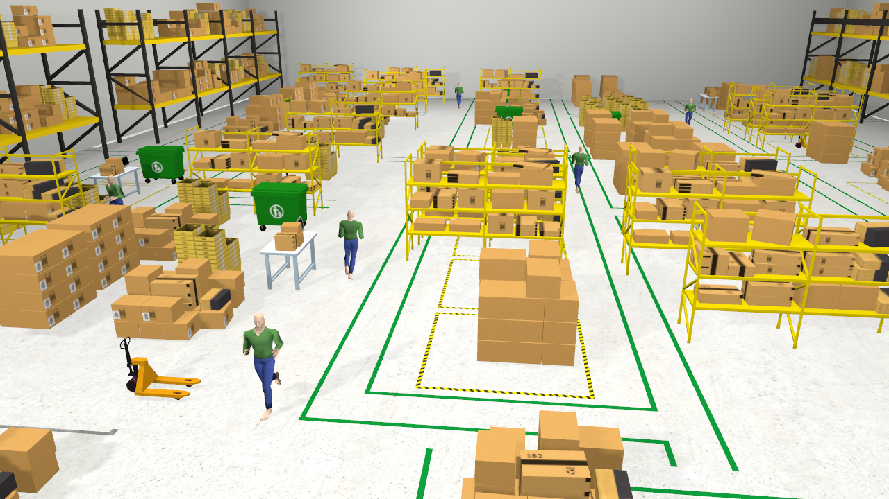
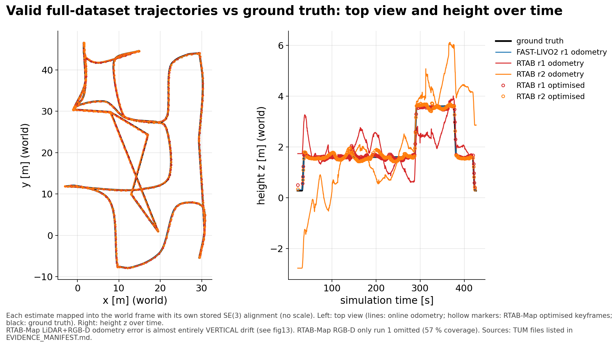

# Dynamic Logistics Warehouse

**GPS-Denied Aerial Robotics · ROS 2 Jazzy · Gazebo Harmonic · PX4 SITL**

A simulation-based robotics engineering project focused on
sensor integration, localisation, 3D warehouse mapping,
and quantitative multi-SLAM evaluation.

**Release:** v0.1.0-alpha — Engineering Showcase

## Project Overview

The project investigates aerial sensing and mapping
in a dynamic warehouse environment with moving actors,
storage racks, and industrial obstacles.

The system combines ROS 2 Jazzy, Gazebo Harmonic,
PX4 SITL, RGB-D sensing, IMU data, and 3D LiDAR.

## Key Results

| Metric | Result |
|---|---|
| Reference trajectory | 396.15 m |
| Dataset duration | 405.33 s |
| Recorded dataset | Approximately 41 GB |
| Common odometry evaluation | 3,487 timestamps |
| Best optimised RTAB-Map ATE | 0.082 m |
| Best observed-map completeness | 98.0% within 0.2 m |

## Multi-SLAM Benchmark

The benchmark investigates FAST-LIVO2, R3LIVE,
and RTAB-Map using recorded simulation data.

### Online Odometry

| Method | 3D ATE RMSE | Horizontal RMSE | Vertical RMSE |
|---|---:|---:|---:|
| FAST-LIVO2 | 0.228 m | 0.227 m | 0.025 m |
| RTAB-Map Run 1 | 0.744 m | 0.075 m | 0.740 m |
| RTAB-Map Run 2 | 1.355 m | 0.103 m | 1.351 m |

FAST-LIVO2 achieved lower overall online 3D ATE.
RTAB-Map achieved lower horizontal error, while
vertical drift dominated its online odometry error.

After graph optimisation, RTAB-Map achieved ATE
values of 0.082 m and 0.116 m on its keyframes.

These optimised results are not online localisation accuracy.

### 3D Mapping

The evaluated RTAB-Map maps achieved observed-map
completeness of 98.0% and 96.8% within 0.2 m.

This metric refers to recorded LiDAR observations
placed using ground-truth poses, not the entire warehouse.

[Read the benchmark report](docs/slam-benchmark/README.md)

## Development Roadmap

Current work covers simulation, sensor integration,
dataset collection, SLAM benchmarking, and 3D mapping.

Planned research includes:

- Autonomous Navigation and Obstacle Avoidance
- Fly-Brain-Inspired Neural Planning
- MuJoCo and learning-based control
- NVIDIA Isaac Sim integration
- Vision-Language Models (VLM)
- Vision-Language-Action Models (VLA)

[Full Development Roadmap](ROADMAP.md)

## Scope and Limitations

This is a simulation-based engineering showcase,
not a validated end-to-end autonomous inventory system.

The benchmark is based on a limited number of runs.
The full dataset and development source code are not
included in this public release.

## Asset Attribution

The warehouse environment incorporates assets derived
from AWS RoboMaker Small Warehouse World and Gazebo
simulation resources. Third-party asset ownership and
applicable licence terms remain with their respective
copyright holders.
