

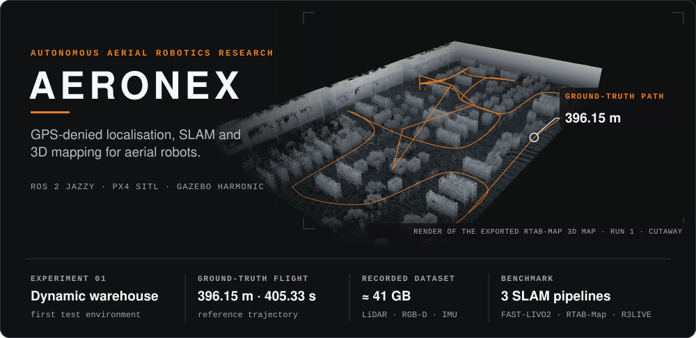

 

&nbsp;
<a href="https://bardiyaaghsami.github.io/AERONEX/slam-benchmark/dashboard.html">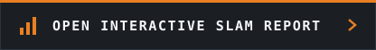</a>&nbsp;

 

<a href="#what-aeronex-does"><b>What it does</b></a> &nbsp;/&nbsp;
<a href="#experiment-01-dynamic-warehouse"><b>Experiment 01</b></a> &nbsp;/&nbsp;
<a href="#technical-architecture"><b>Architecture</b></a> &nbsp;/&nbsp;
<a href="#benchmark-results"><b>Results</b></a> &nbsp;/&nbsp;
<a href="#development-milestones"><b>Milestones</b></a> &nbsp;/&nbsp;
<a href="docs/slam-benchmark/README.md"><b>Report</b></a> &nbsp;/&nbsp;
<a href="ROADMAP.md"><b>Roadmap</b></a>

## What AERONEX does

**AERONEX** is an evolving research and engineering project in autonomous aerial robotics. It develops and
measures GPS-denied localisation, SLAM and 3D mapping for drones, as the foundation for autonomous navigation
and intelligent planning.

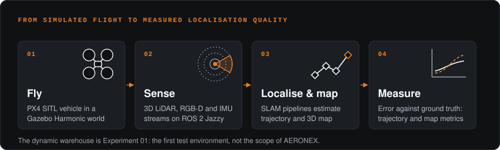

## Experiment 01: Dynamic Warehouse

The first test environment: a simulated warehouse with storage racks, industrial obstacles and moving actors.
A recorded flight through it was replayed into three SLAM pipelines and evaluated against ground truth.

<a href="https://bardiyaaghsami.github.io/AERONEX/demo/">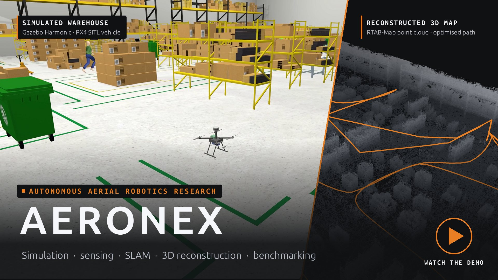</a>

<b><a href="https://bardiyaaghsami.github.io/AERONEX/demo/">Watch the demo</a></b> (about 59 s, no audio): the simulated warehouse, PX4 SITL vehicle and sensors,
LiDAR perception, the RTAB-Map 3D reconstruction and benchmark results. The take-off scene is the PX4 SITL flight test in an
open test world, not the warehouse.

The warehouse world in Gazebo Harmonic (simulator capture).

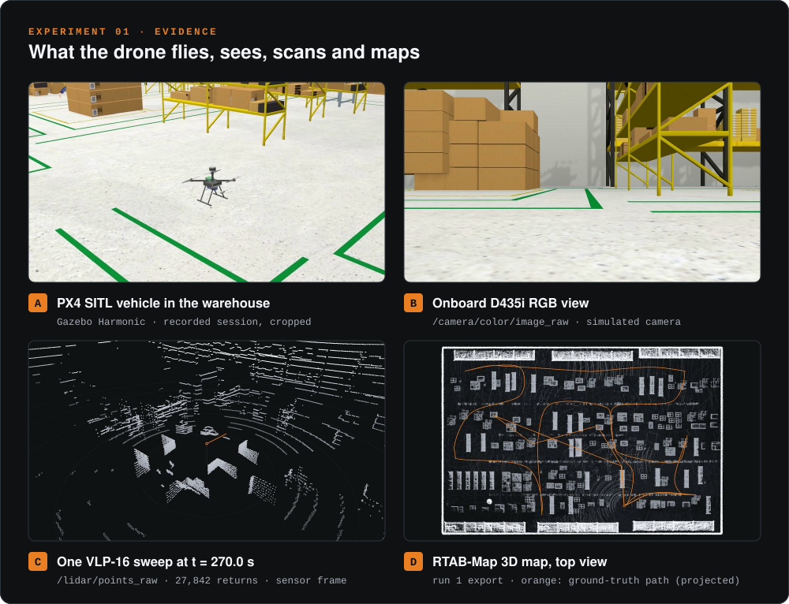

All four panels show real project output: <b>A</b> a frame of a recorded Gazebo session; <b>B</b> a frame of
the <code>/camera/color/image_raw</code> topic; <b>C</b> one <code>/lidar/points_raw</code> sweep read from the
recorded dataset; <b>D</b> the exported RTAB-Map run 1 point cloud with the ground-truth path projected onto it.
C and D are rendered from the data, not simulator screenshots.

**[Explore the 3D reconstruction](https://bardiyaaghsami.github.io/AERONEX/3d-map/)**: rotate, zoom and pan the RTAB-Map point cloud from run 1
(voxel-downsampled to about 738,000 points, original map frame), and toggle the optimised trajectory, the online odometry
and ground truth. It is a static view of exported map data, not a live simulation.

## Technical Architecture

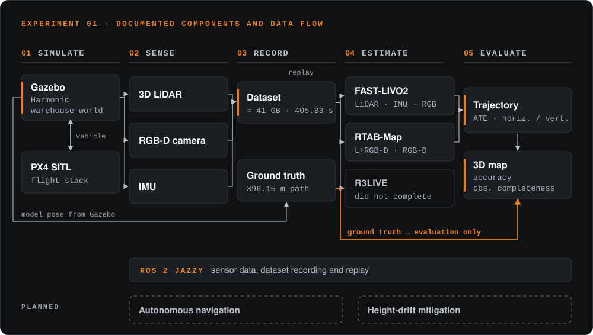

## Benchmark Results

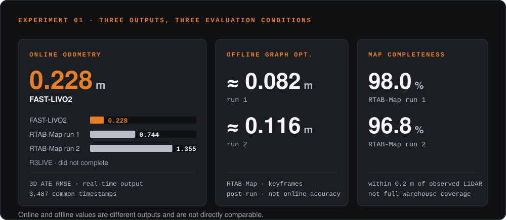

> [!IMPORTANT]
> **Online odometry and offline graph optimisation are different outputs.** All three online results are
> evaluated on the same 3,487 timestamps. RTAB-Map's ≈ 0.082 m and ≈ 0.116 m come from its pose graph after the
> run, at keyframes, with loop closures that use later information. They are **not** online localisation accuracy.

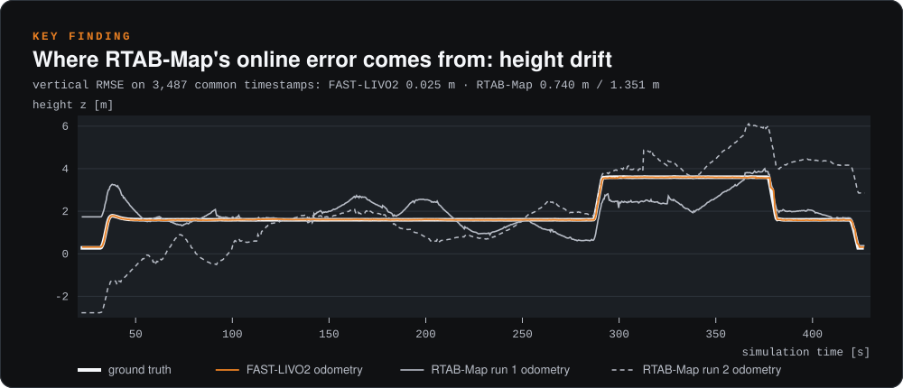

| Online odometry | 3D ATE RMSE | Horizontal RMSE | Vertical RMSE |
|---|---:|---:|---:|
| FAST-LIVO2 | **0.228 m** | 0.227 m | 0.025 m |
| RTAB-Map LiDAR+RGB-D, run 1 | 0.744 m | **0.075 m** | 0.740 m |
| RTAB-Map LiDAR+RGB-D, run 2 | 1.355 m | 0.103 m | 1.351 m |

FAST-LIVO2 achieved the lower overall online 3D ATE. RTAB-Map achieved the lower horizontal error, while vertical
drift dominated its online odometry error.

> [!NOTE]
> The RTAB-Map maps reached observed-map completeness of approximately 98.0 % and 96.8 % within 0.2 m. This is
> measured against the recorded LiDAR observations placed with ground-truth poses: it describes how much of what the
> sensor observed is reproduced in the map, **not** coverage of the entire warehouse.

| Pipeline | Outcome in the recorded full run |
|---|---|
| FAST-LIVO2 | Trajectory evaluated · no evaluable saved map |
| RTAB-Map LiDAR+RGB-D | Two runs evaluated · trajectories and 3D maps |
| RTAB-Map RGB-D only | Tracking incomplete |
| R3LIVE | Did not complete its benchmark run |

These findings come from one simulated dataset with a limited number of runs per pipeline and do not establish a
statistically robust ranking. Method, metrics and limitations: **[Multi-SLAM benchmark report](docs/slam-benchmark/README.md)**

**[Open the interactive SLAM report](https://bardiyaaghsami.github.io/AERONEX/slam-benchmark/dashboard.html)**: every run, all 18 report figures and a filterable
table of 460 metric records with their provenance.

<b>Benchmark report figures</b>

 

<table>
<tr>
<td width="50%" valign="top">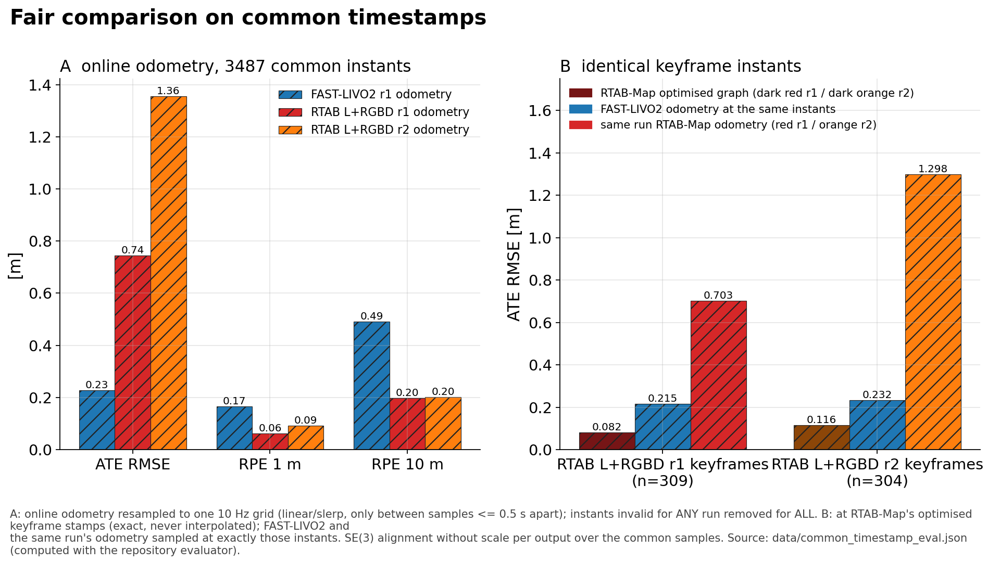 Common-timestamp comparison</td>
<td width="50%" valign="top">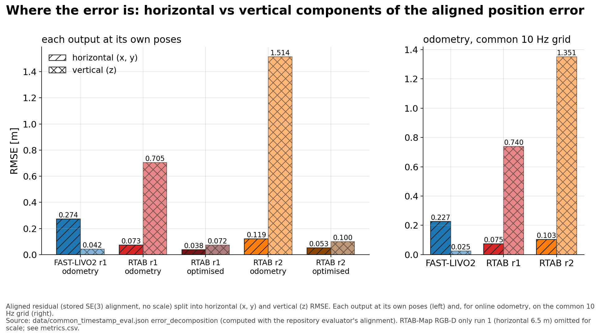 Horizontal vs vertical error</td>
</tr>
<tr>
<td width="50%" valign="top"> Trajectories vs ground truth</td>
<td width="50%" valign="top">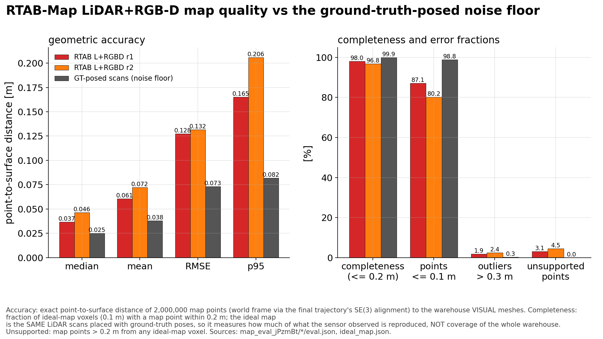 3D map quality</td>
</tr>
</table>

[ATE comparison figure](docs/slam-benchmark/figures/fig02_ate.png)

## Development Milestones

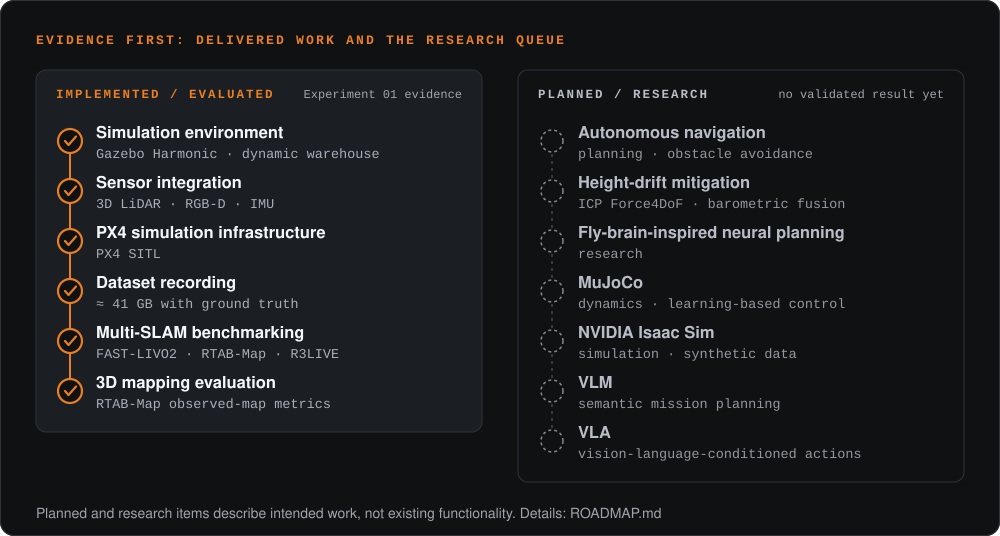

Status definitions, priorities and the full milestone list: **[ROADMAP.md](ROADMAP.md)**

## Repository Contents

| Path | Contents |
|---|---|
| [`ROADMAP.md`](ROADMAP.md) | Milestones, priorities and research scope |
| [`docs/slam-benchmark/`](docs/slam-benchmark/README.md) | Multi-SLAM benchmark summary and figures |
| [`docs/slam-benchmark/dashboard.html`](docs/slam-benchmark/dashboard.html) | Interactive benchmark report (public edition), [live page](https://bardiyaaghsami.github.io/AERONEX/slam-benchmark/dashboard.html) |
| [`docs/3d-map/`](docs/3d-map/) | 3D reconstruction viewer and its downsampled point-cloud data, [live page](https://bardiyaaghsami.github.io/AERONEX/3d-map/) |
| [`docs/demo/`](docs/demo/), [`docs/media/`](docs/media/) | Demo video page, video and preview images, [live page](https://bardiyaaghsami.github.io/AERONEX/demo/) |
| [`docs/images/`](docs/images/) | Simulator imagery |
| [`assets/`](assets/) | README graphics and evidence images |

> [!NOTE]
> This public repository is a **documentation and results showcase**. The ROS 2 development source code, the
> original ≈ 41 GB dataset and the complete research evidence are not included, so it contains no build or run
> instructions.

## Scope and Limitations

This is a simulation-based engineering showcase, not a validated end-to-end autonomous inventory system. No
autonomous warehouse inventory mission has been completed.

The benchmark is based on a limited number of runs. The full dataset and development source code are not
included in this public release.

## Asset Attribution

The warehouse environment incorporates assets derived from AWS RoboMaker Small Warehouse World and Gazebo
simulation resources. Third-party asset ownership and applicable licence terms remain with their respective
copyright holders.

 

<b>AERONEX</b> · Autonomous Aerial Robotics Research · v0.1.0-alpha engineering showcase

