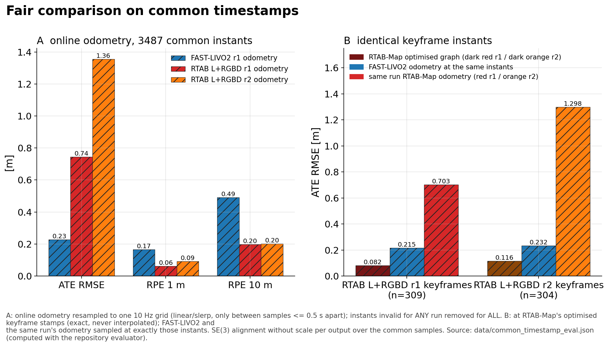
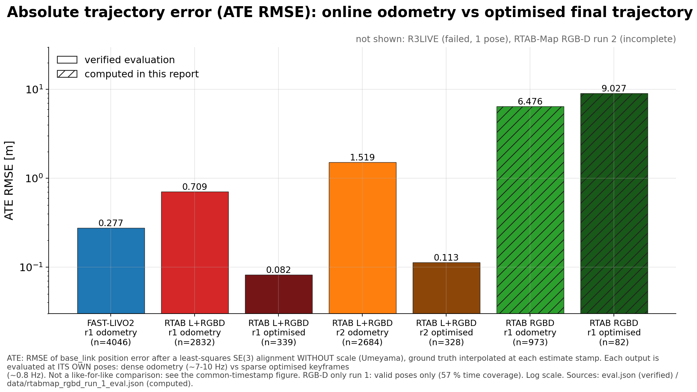
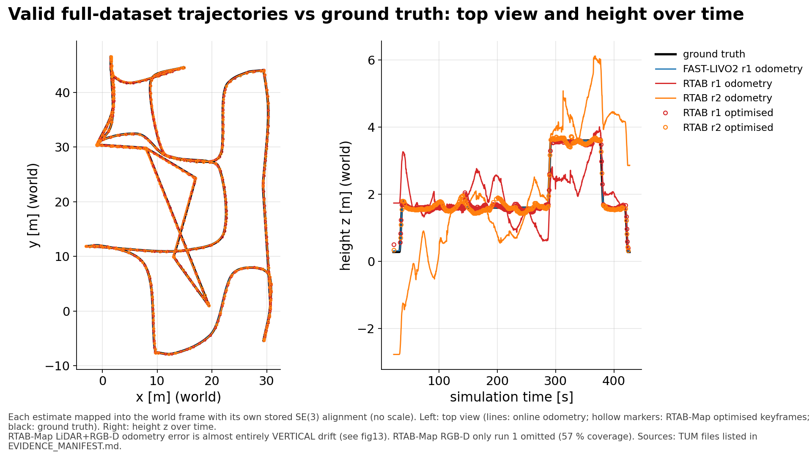
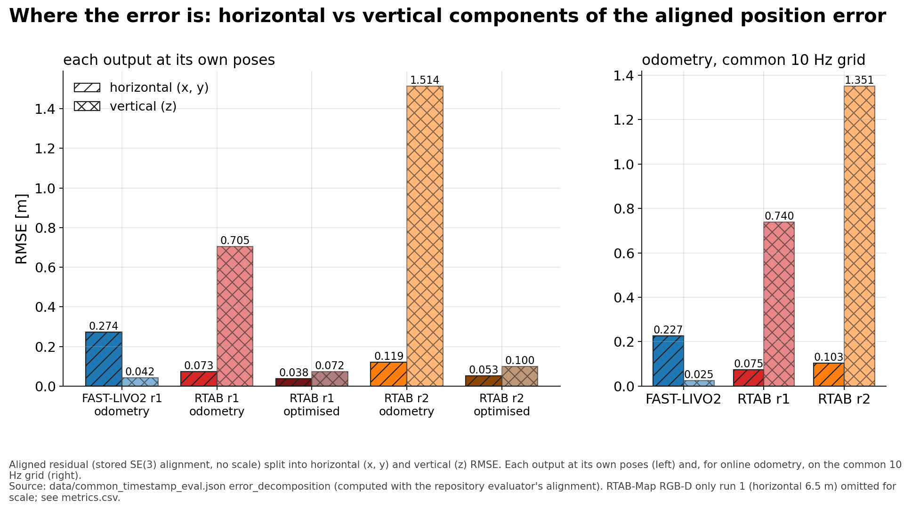
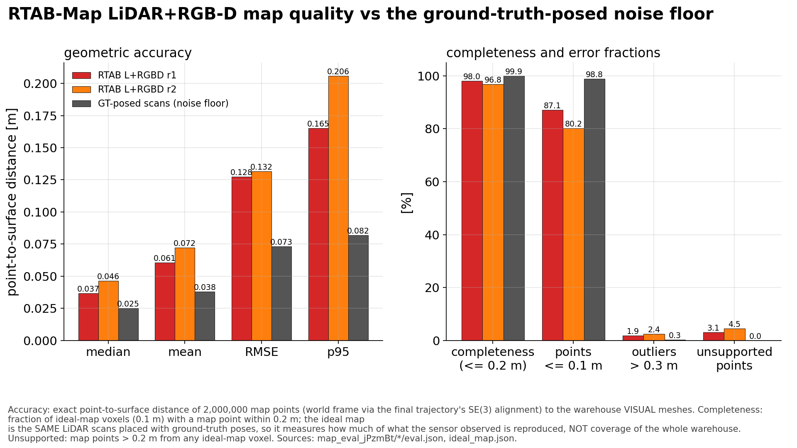

# Multi-SLAM Benchmark

A quantitative evaluation of localisation and 3D mapping
in a simulated dynamic warehouse using ROS 2 Jazzy.

## Experimental Scope

- Recorded dataset: approximately 41 GB
- Ground-truth trajectory: 396.15 m
- Recording duration: 405.33 s
- Methods: FAST-LIVO2, R3LIVE and RTAB-Map
- Environment: Gazebo Harmonic and PX4 SITL

## Key Findings

On 3,487 common online-odometry timestamps:

| Method | 3D ATE RMSE | Horizontal RMSE | Vertical RMSE |
|---|---:|---:|---:|
| FAST-LIVO2 | 0.228 m | 0.227 m | 0.025 m |
| RTAB-Map LiDAR+RGB-D Run 1 | 0.744 m | 0.075 m | 0.740 m |
| RTAB-Map LiDAR+RGB-D Run 2 | 1.355 m | 0.103 m | 1.351 m |

FAST-LIVO2 achieved lower overall online 3D ATE.
RTAB-Map achieved lower horizontal error, but suffered
significant vertical drift.

After pose-graph optimisation, RTAB-Map achieved ATE
RMSE values of 0.082 m and 0.116 m on its keyframes.
These are offline optimised results, not online accuracy.

The RTAB-Map maps achieved observed-map completeness
of approximately 98.0% and 96.8% within 0.2 m.

## Selected Results

## Limitations

These findings come from one simulated dataset, with
limited runs per pipeline. They do not establish a
statistically robust ranking.

Map completeness measures coverage against the same
recorded LiDAR observations placed using ground-truth
poses, not the entire warehouse.

R3LIVE failed in the recorded full run. RGB-D-only
tracking was incomplete. FAST-LIVO2 did not produce
an evaluable saved map.

The full dataset, complete research evidence and
development source code are not included in this
public-facing benchmark summary.
